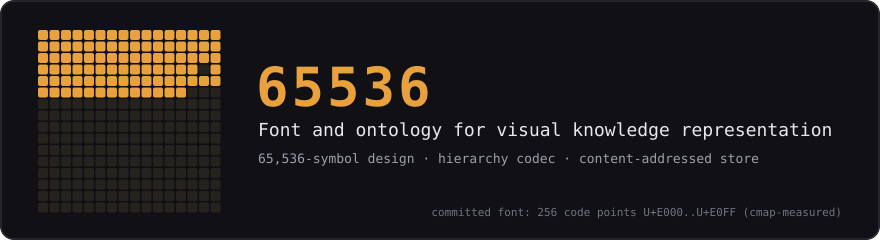

# 65536 — Font and Ontology for Visual Knowledge Representation

<p align="center"></p>

> Verified on the reference machine (2026-11-05):
> `python3 -m pytest tests/ -q` → **129 passed**; the four root modules and
> `julia hierarchy.jl` exit 0; `python3 tests/parity_check.py` → **15 passed,
> 0 failed** under Julia 1.12.6 (also 15/15 with `--py` and with `--jl`);
> all three demos exit 0. The committed font's cmap measures **256 code
> points (U+E000..U+E0FF): 92 character-pattern slots, 164 reserved**.

**65,536** is a TrueType font and ontology project whose code points carry
meaning drawn from the O-OIS grammar — each symbol is a small picture
standing for an entity kind, a relation, a subtype, an epistemic tag, or a
loading control. Where POINTS is optimised for machines (fixed size, bit
packing, parity), **65536 is optimised for people** — pictures, hierarchy,
immediate recognition.

The committed font implements the first Private-Use block — a 16 × 16
address space at U+E000..U+E0FF, measured with fontTools;
`assets/symbol_sheet.png` renders the complete cmap exactly as the font
draws it (the 164 reserved slots emit the short baseline dash the font
defines). Growing the font toward the 65,536-symbol design target
described in `structure.md` is future work — rendering varies by viewer,
so any capacity number must be measured, not declared. The **grammar,
hierarchy, and codec behaviour are fully specified and fully implemented
here**.

## Repository layout

| Path | Role |
|---|---|
| `65536-Glyph.ttf` | The TrueType font (256-point PUA block measured 2026-11-05; 65,536 is the design target) |
| `hierarchy.py` | The hierarchy codec — tier/priority derivation from declared dependencies |
| `hierarchy.jl` | Julia companion of `hierarchy.py`; standalone (executed under Julia 1.12.6 on 2026-11-05, exit 0) |
| `payload_codec.py` | Payload encoding/decoding for glyph content |
| `content_store.py` | Content-addressed store for glyphs and fragments |
| `bootstrap_block.py` | Bootstrap block: the first block of a chain (fixed 267-byte header) |
| `ontology.md`, `structure.md`, `hierarchy.md` | The three design documents: the structural theory of information, the structural framework, and the ingestion methodology |
| `jl/` | The Python↔Julia parity sources used by `tests/parity_check.py`: `bootstrap_block.jl`, `payload_codec.jl`, `content_store.jl`, plus self-test runners (`run_*.jl`, `run_bench.jl`) |
| `tests/jl/` | Self-contained copies of the three module sources that run their own self-tests when executed directly (`julia tests/jl/content_store.jl`) — all three verified exit 0 under Julia 1.12.6 on 2026-11-05 |
| `tests/` | 129 pytest tests — including the property suite (`test_properties.py`); `parity_check.py` (15 cross-language checks, three modes); benchmarks in `bench/`; the golden-vector generator `generate_golden.py` feeding `vectors/golden/`; three demos in `demos/` |
| `experiments/` | `font_bitmap.py` (a font generator for the two-glyph protocol), `glyph_protocol.py`, `two_glyph_test.py` |
| `tools/`, `assets/` | Asset generator (`make_doc_assets.py`) and generated assets (banner, complete-cmap symbol sheet, `font-visual-test.png`) |
| `prior/` | Superseded documents kept verbatim for provenance (`loadbearing_proof.md`) |

### About the two `jl/` directories

`jl/` is what the parity harness drives: `parity_check.py` runs its
`run_*.jl` scripts, which `include` the root `jl/` modules. The copies in
`tests/jl/` are pinned, deliberately-standalone ports — each defines its
own outcome enums and error types and `include`s its own
`bootstrap_block.jl`, so its docstrings' no-struct-redefinition constraint
is never tripped during a direct run. The two copies differ slightly in
docstrings and includes; treat them as two conscious ports, not one truth
and one stale copy.

## Quick start

Verified commands (repository root):

```bash
python3 -m pytest tests/ -q          # all 129 tests
python3 tests/parity_check.py        # Python+Julia parity: 15 passed, 0 failed
python3 hierarchy.py                 # tier derivation walkthrough (exit 0)
python3 payload_codec.py             # payload encode/decode walkthrough
python3 content_store.py             # content-addressed store walkthrough
python3 bootstrap_block.py           # bootstrap block walkthrough
julia hierarchy.jl                   # the Julia companion, self-checking
python3 tests/demos/demo_full_pipeline.py   # bootstrap→payload→store lifecycle
python3 tools/make_doc_assets.py     # regenerate assets/ deterministically
```

`parity_check.py` also accepts `--py` (Python assertions only) and `--jl`
(Julia results only); all three modes reported 15/15 on 2026-11-05.

## Notes

- `tests/MASTER_PLAN.md` is the original suite architecture plan, kept as
  history with a dated status note; `tests/BENCHMARK_FINDINGS.md` holds
  the cross-language parity status and the 65536-vs-CBOR benchmark
  interpretation (CBOR wins throughput; 65536 wins storage overhead and
  provides content addressing, DAG integrity, and binary parity).
- The three design documents read in this order:
  `hierarchy.md` → `ontology.md` → `structure.md` (the discriminative,
  concluded versions are `point1.md`/`point2.md` in the POINTS repository,
  which supersede earlier drafts).

## Relationship to the ONE paper

65536 is one of the three instantiations of the O-OIS grammar in
"Maximum Semantic Capacity via the Ontology of Optimal Information
Structure" (2026). Its font, hierarchy codec, payload codec, and content
store demonstrate the same shared grammar in a human-facing, image form —
the "very large alphabet where every symbol is a whole idea". The sibling
repositories are **POINTS** (the machine-facing 8,192-byte glyph codec)
and **MSCA** (the tiered agent-memory archive the grammar drives).

## License

MIT — see [`LICENSE`](LICENSE).
